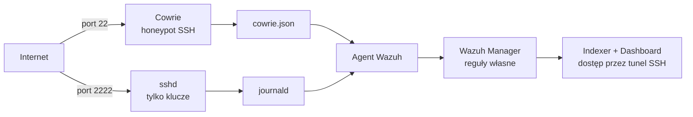

# Detekcje i obserwacje z własnego honeypota SSH

Repozytorium reguł detekcyjnych, playbooków i ustaleń śledczych z serwera,
który utrzymuję i monitoruję samodzielnie. Wszystkie dane pochodzą z
prawdziwego ruchu internetowego — nie z symulacji ani z ćwiczeń.

## Architektura

Honeypot jest jedyną usługą celowo wystawioną publicznie. Panel SIEM-a
i wszystkie porty wewnętrzne są związane z pętlą lokalną i dostępne
wyłącznie przez tunel SSH.

## Skala obserwacji

Stan na 18.09.2026, po 11 dniach pracy ciągłej (08–18.09):

| | |
|---|---|
| Zdarzenia | 353 930 |
| Unikalne adresy źródłowe | 1 336 |
| Sesje | 46 041 |
| Udział jednego bloku `109.160.32.0/24` | 81% całego ruchu |

## Zawartość

| Katalog | Co zawiera |
|---|---|
| `rules/` | reguły Wazuha, numery 100100–100111 |
| `playbooks/` | procedury reagowania, po jednej na regułę |
| `findings/` | konkretne obserwacje z analizy zebranych danych |

## Reguły

| ID | Poziom | Zdarzenie | MITRE |
|---|---|---|---|
| 100101 | 3 | nieudane logowanie | T1110 |
| 100102 | 3 | przyjęte poświadczenia | T1078 |
| 100103 | 10 | wykonanie komendy | T1059 |
| 100104 | 6 | zapis pliku na hoście (reguła rodzic) | — |
| 100105 | 13 | klucz SSH dopisany do `authorized_keys` | T1098.004 |
| 100106 | 13 | materiał do ruchu bocznego (klucz prywatny, `ssh_config`) | T1021.004 |
| 100107 | 14 | klucz kampanii Outlaw/Dota (`mdrfckr`) | T1098.004 |
| 100108 | 3 | rozpoznanie systemu (potomna wobec 100103) | T1082 |
| 100110–100111 | 3 | kontrola potoku (canary) | — |

## Korekty reguł po weryfikacji na danych

Reguły powstały przed zebraniem materiału i po 11 dniach wymagały poprawek.
Zapisuję je, bo sposób korygowania detekcji jest częścią pracy, a nie
błędem do ukrycia.

**100104 — usunięte mapowanie T1105.** Reguła deklarowała *Ingress Tool
Transfer*. W całym materiale ani jedno zdarzenie nie miało wypełnionego pola
`url` — pobrania z sieci nie było w ogóle. Cowrie kwalifikuje jako
`file_download` również przechwycone przekierowanie wyjścia powłoki, co
pierwotnie zinterpretowałem błędnie. Faktyczne zachowanie to zapis klucza do
`authorized_keys`, czyli T1098.004. Reguła rodzic nie deklaruje już żadnej
techniki; mapowania przeniesiono do reguł potomnych 100105–100107.

**100102 — poziom obniżony z 6 na 3.** Cowrie akceptuje niemal każde hasło,
więc „udane logowanie" jest stanem normalnym czujnika, nie incydentem.
Na poziomie 6 reguła wygenerowała 43 383 alerty, które niczego nie
różnicowały.

**100104 — poziom obniżony z 12 na 6.** Po wprowadzeniu reguł potomnych
o poziomach 13–14 rodzic nie musi sam podnosić wagi.

**100103 — dodana reguła potomna 100108.** Czyste rozpoznanie systemu
(`uname`, `lscpu`, `whoami`, `uptime`, `df` i pokrewne) schodzi na poziom 3
z mapowaniem T1082, a 100103 zostaje na poziomie 10 dla komend zmieniających
stan systemu. Wzorzec dopuszcza po nazwie komendy wyłącznie spacje, litery,
cyfry, kropkę, ukośnik i myślnik — pierwszy średnik, potok, `&&` albo `$(`
przerywa dopasowanie. Bez tego wystarczyłoby dopisać `uname -a;` przed
właściwym poleceniem, żeby samemu obniżyć sobie poziom alertu.

## Kontrola działania potoku

Własny ruch testowy nie jest wyciszany, lecz oznaczany grupą `canary`
przez stały login i znacznik w komendzie. Wyciszenie do zera odbiera
jedyny sposób sprawdzenia, czy detekcja nadal żyje — cichy SIEM wygląda
identycznie jak spokojna sieć. Brak zdarzenia kontrolnego przez dobę
jest sygnałem awarii łańcucha.

## Zastrzeżenia

Repozytorium nie zawiera surowych logów ani próbek pobranych przez
atakujących. Adresy źródłowe pojawiają się wyłącznie w opisach ustaleń,
tam gdzie są istotne dla wniosku.
