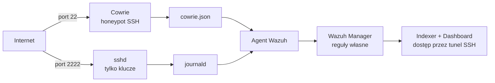

# Detekcje i obserwacje z własnego honeypota SSH

Repozytorium reguł detekcyjnych, playbooków i ustaleń śledczych z serwera,
który utrzymywałem i monitorowałem samodzielnie. Wszystkie dane pochodzą z
prawdziwego ruchu internetowego — nie z symulacji ani z ćwiczeń.

> **Projekt zakończony 25.11.2026.** Czujnik działał od 08.09 do 25.11.2026,
> po czym maszyna została przeinstalowana. Podsumowanie całości:
> [raport końcowy](findings/2026-11-25-raport-koncowy.md).

## Architektura

Honeypot jest jedyną usługą celowo wystawioną publicznie. Panel SIEM-a
i wszystkie porty wewnętrzne są związane z pętlą lokalną i dostępne
wyłącznie przez tunel SSH.

## Skala obserwacji

Stan końcowy, 25.11.2026. Źródło: alerty w indeksie Wazuha, bez własnego
ruchu kontrolnego.

| | |
|---|---|
| Okres | 10.09 – 25.11.2026 (76 dni) |
| Alerty | 905 094 |
| Unikalne adresy źródłowe | 4 385 |
| Sesje z co najmniej jednym alertem | ok. 390 tys. |
| Przechwycone pliki | 137 (wyłącznie skróty SHA-256, w `findings/ioc/`) |
| Udział jednego bloku `109.160.32.0/24` | 57,6% alertów |

Wcześniejsze migawki liczyły surowe zdarzenia Cowrie, a nie alerty, więc nie
należy ich porównywać wprost z powyższymi. Archiwum:
[`docs/historia-projektu.md`](docs/historia-projektu.md).

## Zawartość

| Katalog | Co zawiera |
|---|---|
| `rules/` | reguły Wazuha, numery 100100–100112 |
| `playbooks/` | procedury reagowania, po jednej na regułę |
| `findings/` | konkretne obserwacje z analizy zebranych danych, raport końcowy |
| `findings/ioc/` | skróty SHA-256 plików przechwyconych przez honeypota (bez próbek) |
| `docs/` | utwardzanie systemu, utrzymanie bez nadzoru, historia projektu |

## Reguły

| ID | Poziom | Zdarzenie | MITRE |
|---|---|---|---|
| 100101 | 3 | nieudane logowanie | T1110 |
| 100102 | 3 | przyjęte poświadczenia | T1078 |
| 100103 | 10 | wykonanie komendy | T1059 |
| 100104 | 6 | zapis pliku na hoście (reguła rodzic) | — |
| 100105 | 13 | klucz SSH dopisany do `authorized_keys` | T1098.004 |
| 100106 | 13 | materiał do ruchu bocznego (klucz prywatny, `ssh_config`) | T1021.004 |
| 100107 | 14 | klucz kampanii Outlaw/Dota (`mdrfckr`) | T1098.004 |
| 100108 | 3 | rozpoznanie systemu (potomna wobec 100103) | T1082 |
| 100109 | 12 | plik przesłany kanałem SCP/SFTP | T1105 |
| 100110–100111 | 3 | kontrola potoku (canary) | — |
| 100112 | 5 | test autentyczności powłoki (potomna wobec 100103) | T1497.001 |

Plik reguł zawiera też regułę 100001 — przykład z domyślnego szablonu Wazuha,
dopasowujący wyłącznie adres `1.1.1.1`. Nie jest częścią projektu.

## Korekty reguł po weryfikacji na danych

Reguły powstały przed zebraniem materiału i po 11 dniach wymagały poprawek.
Zapisuję je, bo sposób korygowania detekcji jest częścią pracy, a nie
błędem do ukrycia.

**100104 — usunięte mapowanie T1105.** Reguła deklarowała *Ingress Tool
Transfer*. W całym materiale ani jedno zdarzenie nie miało wypełnionego pola
`url` — pobrania z sieci nie było w ogóle. Cowrie kwalifikuje jako
`file_download` również przechwycone przekierowanie wyjścia powłoki, co
pierwotnie zinterpretowałem błędnie. Faktyczne zachowanie to zapis klucza do
`authorized_keys`, czyli T1098.004. Reguła rodzic nie deklaruje już żadnej
techniki; mapowania przeniesiono do reguł potomnych 100105–100107.

**100102 — poziom obniżony z 6 na 3.** Cowrie akceptuje niemal każde hasło,
więc „udane logowanie" jest stanem normalnym czujnika, nie incydentem.
Na poziomie 6 reguła wygenerowała 43 383 alerty, które niczego nie
różnicowały.

**100104 — poziom obniżony z 12 na 6.** Po wprowadzeniu reguł potomnych
o poziomach 13–14 rodzic nie musi sam podnosić wagi.

**100103 — dodana reguła potomna 100108.** Czyste rozpoznanie systemu
(`uname`, `lscpu`, `whoami`, `uptime`, `df` i pokrewne) schodzi na poziom 3
z mapowaniem T1082, a 100103 zostaje na poziomie 10 dla komend zmieniających
stan systemu. Wzorzec dopuszcza po nazwie komendy wyłącznie spacje, litery,
cyfry, kropkę, ukośnik i myślnik — pierwszy średnik, potok, `&&` albo `$(`
przerywa dopasowanie. Bez tego wystarczyłoby dopisać `uname -a;` przed
właściwym poleceniem, żeby samemu obniżyć sobie poziom alertu.

**100109 i 100112 — luka znaleziona przy zamknięciu projektu.** Reguła 100104
opisywała tylko jeden z dwóch typów zdarzeń, którymi Cowrie zapisuje pliki
(`file_download`). Przesłania przez SCP/SFTP (`file_upload`) przez cały projekt
nie wywołały ani jednego alertu, choć w samych ostatnich 30 dniach było ich 1 274.
Nowe reguły sprawdzono `wazuh-logtest` na prawdziwych zdarzeniach i wdrożono
25.11; mapowanie T1105 wróciło, tym razem zasadnie. Szczegóły:
[`findings/2026-11-25-od-profilowania-do-droppera.md`](findings/2026-11-25-od-profilowania-do-droppera.md).

## Kontrola działania potoku

Własny ruch testowy nie jest wyciszany, lecz oznaczany grupą `canary`
przez stały login i znacznik w komendzie. Wyciszenie do zera odbiera
jedyny sposób sprawdzenia, czy detekcja nadal żyje — cichy SIEM wygląda
identycznie jak spokojna sieć. Brak zdarzenia kontrolnego przez dobę
jest sygnałem awarii łańcucha.

## Utwardzanie systemu

Host jest oceniany modułem SCA Wazuha względem CIS Debian 13 Benchmark.
Stan po remediacji: **124 kontrole zaliczone, 66 niezaliczonych (65%)**.
Wynik nie zmienił się do zamknięcia projektu, mimo 96 aktualizacji pakietów.

Z pozostałych 66 — 59 jest odrzuconych świadomie, z uzasadnieniem dla każdej,
a 7 nie da się zaliczyć, bo wzorce w polityce oceny są zakodowane błędnie.
Pełny rozbiór wraz z kontrolami zastępczymi:
[`docs/utwardzanie-cis.md`](docs/utwardzanie-cis.md).

Mechanizmy pracy bez nadzoru — timery, czujnik martwego człowieka, wartownik
stanu systemu, audyt całości:
[`docs/utrzymanie-bez-nadzoru.md`](docs/utrzymanie-bez-nadzoru.md).

## Jak powstało to repozytorium

Lab zbudowałem i utrzymywałem samodzielnie. Przy konfiguracji i redakcji korzystałem
ze wsparcia asystenta AI; wszystkie polecenia wykonałem na własnej maszynie,
a ustalenia w katalogu `findings/` pochodzą z analizy ruchu zebranego przez ten
czujnik, nie z przykładów z dokumentacji.

## Zastrzeżenia

Repozytorium nie zawiera surowych logów ani próbek pobranych przez
atakujących. Adresy źródłowe pojawiają się wyłącznie w opisach ustaleń,
tam gdzie są istotne dla wniosku. Skróty SHA-256 w `findings/ioc/` pozwalają
zidentyfikować przechwycone pliki, ale nie pozwalają ich odtworzyć.
