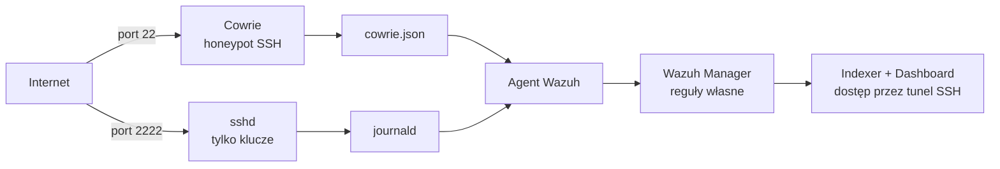

# Detekcje i obserwacje z własnego honeypota SSH

Repozytorium reguł detekcyjnych, playbooków i ustaleń śledczych z serwera,
który utrzymuję i monitoruję samodzielnie. Wszystkie dane pochodzą z
prawdziwego ruchu internetowego — nie z symulacji ani z ćwiczeń.

## Architektura

Honeypot jest jedyną usługą celowo wystawioną publicznie. Panel SIEM-a
i wszystkie porty wewnętrzne są związane z pętlą lokalną i dostępne
wyłącznie przez tunel SSH.

## Zawartość

| Katalog | Co zawiera |
|---|---|
| `rules/` | reguły Wazuha, numery 100100–100111 |
| `playbooks/` | procedury reagowania, po jednej na regułę |
| `findings/` | konkretne obserwacje z analizy zebranych danych |

## Reguły

| ID | Poziom | Zdarzenie | MITRE |
|---|---|---|---|
| 100101 | 3 | nieudane logowanie | T1110 |
| 100102 | 6 | przyjęte poświadczenia | T1078 |
| 100103 | 10 | wykonanie komendy | T1059 |
| 100104 | 12 | próba pobrania pliku | T1105 |
| 100110–100111 | 3 | kontrola potoku (canary) | — |

## Kontrola działania potoku

Własny ruch testowy nie jest wyciszany, lecz oznaczany grupą `canary`
przez stały login i znacznik w komendzie. Wyciszenie do zera odbiera
jedyny sposób sprawdzenia, czy detekcja nadal żyje — cichy SIEM wygląda
identycznie jak spokojna sieć. Brak zdarzenia kontrolnego przez dobę
jest sygnałem awarii łańcucha.

## Zastrzeżenia

Repozytorium nie zawiera surowych logów ani próbek pobranych przez
atakujących. Adresy źródłowe pojawiają się wyłącznie w opisach ustaleń,
tam gdzie są istotne dla wniosku.
