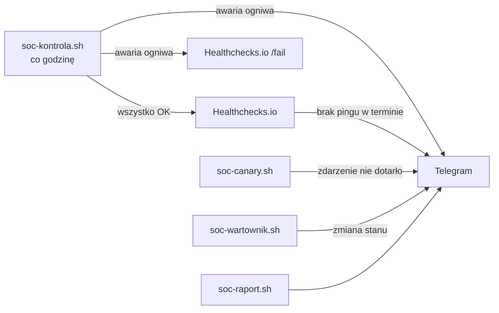

# Utrzymanie maszyny bez nadzoru

Lab ma działać tygodniami bez logowania się na maszynę, a jednocześnie nie
milczeć, gdy coś się zepsuje. Ten dokument opisuje mechanizmy, które to
zapewniają, i założenie, na którym są zbudowane:

> **Cichy SIEM wygląda identycznie jak spokojna sieć.**
> Brak alertów nie jest dowodem, że nic się nie dzieje — jest dowodem, że nic
> nie dotarło. Dlatego każdy element łańcucha musi sam się zgłaszać.

## Zadania cykliczne

Wszystkie na timerach systemd z `Persistent=true` — po wyłączeniu i włączeniu
maszyny pominięty termin zostaje nadrobiony. `cron` nie jest zainstalowany.

| Zadanie | Harmonogram | Co robi |
|---|---|---|
| `soc-kontrola.sh` | co godzinę | pięć ogniw łańcucha: kontenery, agent, zapis do `cowrie.json`, dopływ zdarzeń do indeksu, miejsce na dysku |
| `soc-utrzymanie.sh` | 03:30 | kompresja zrotowanych logów Cowrie, retencja 30 dni, kopia konfiguracji do `/srv/lab/kopie`, retencja kopii 14 dni |
| `soc-wartownik.sh` | 05:00 | porównanie siedmiu obszarów systemu ze stanem wzorcowym |
| `soc-canary.sh` | 06:30 | wygenerowanie własnego zdarzenia i sprawdzenie, czy dotarło do indeksu |
| `soc-raport.sh` | 07:00 | raport z poprzedniej pełnej doby na Telegram |

## Łańcuch powiadomień

Healthchecks.io pełni rolę **czujnika martwego człowieka**: ping przychodzi tylko
wtedy, gdy wszystkie pięć ogniw przeszło. Jeżeli maszyna padnie, straci sieć albo
skrypt kontrolny przestanie się uruchamiać, ping nie przyjdzie i powiadomienie
wyjdzie **z zewnątrz**. Awaria, która zabija też kanał alarmowy, zostaje zgłoszona
przez stronę trzecią.

## Ruch kontrolny (canary)

Codziennie o 06:30 skrypt loguje się na honeypota dedykowanym kontem i wykonuje
komendę ze znacznikiem i datą. Zdarzenie przechodzi całą drogę: Cowrie → plik
JSON → agent → manager → reguła → indeks. Po dziesięciu minutach skrypt sprawdza,
czy alert jest w indeksie. Powiadomienie wychodzi **tylko przy porażce**.

Własny ruch nie jest wyciszany, lecz oznaczany grupą `canary`. Wyciszenie do zera
odebrałoby jedyny sposób sprawdzenia, czy detekcja nadal żyje.

## Wartownik stanu systemu

`soc-wartownik.sh` trzyma odcisk siedmiu obszarów (m.in. klucze
`authorized_keys`, konta, jednostki systemd, zadania cykliczne, nasłuchujące
porty) i codziennie porównuje stan bieżący ze wzorcowym. Każda różnica idzie na
Telegram wraz z linią kontekstu, a świadomą zmianę zatwierdza się jawnie
przełącznikiem `--zatwierdz`.

Mechanizm sprawdził się w praktyce — dodanie klucza SSH z telefonu zostało
zgłoszone w ciągu doby, z dokładną treścią dopisanej linii.

## Audyt całości

`soc-pelny-audyt.sh` to jeden skrypt, jedenaście sekcji: logowania, klucze,
konta, trwałość, procesy, połączenia wychodzące, nasłuchujące porty,
integralność plików pakietów, stan kontenerów i agenta, aktualizacje,
stan repozytorium. Kończy się albo jednym zdaniem o gotowości maszyny do pracy
bez nadzoru, albo listą pozycji do przejrzenia.

Kontrola integralności porównuje `dpkg --verify` z listą
`/etc/soc-pliki-zmienione-swiadomie.txt`, w której każda świadoma modyfikacja
pliku pakietu ma uzasadnienie. Skuteczność tej kontroli zweryfikowałem,
tymczasowo usuwając jeden plik z listy i sprawdzając, że audyt go zgłasza.

## Aktualizacje

`unattended-upgrades` instaluje poprawki bezpieczeństwa i restartuje maszynę
o 04:30, jeśli restart jest wymagany, usuwając przy tym nieużywane jądra.
Raport dzienny podaje liczbę zainstalowanych pakietów i informację, czy restart
jest potrzebny — więc zmiana tego stanu z dnia na dzień jest widoczna w historii
powiadomień, a nie tylko na maszynie.

## Wynik: 56 dni bez nadzoru (01.10 – 25.11.2026)

| Mechanizm | Wynik |
|---|---|
| `soc-kontrola.sh` | 1 332 uruchomienia, wszystkie `kontrola: OK` |
| `soc-wartownik.sh` | 56 przebiegów, za każdym razem „bez zmian” |
| `soc-canary.sh` | zdarzenie kontrolne w indeksie w 54 dniach na 55 |
| `soc-utrzymanie.sh`, `soc-raport.sh` | po 56 uruchomień bez błędu |
| `unattended-upgrades` | 96 aktualizacji pakietów, pięć automatycznych restartów o 04:30 |

Jedyna awaria — 04.10 zdarzenie kontrolne nie dotarło do indeksu — została
wykryta i zgłoszona przez sam mechanizm. Kontrola godzinowa przechodziła tego
dnia, więc zawiódł pojedynczy sygnał, nie potok.

Wniosek dla projektowania takich mechanizmów: **skrypt kontrolny zakończył się
poprawnie także w dniu awarii**, bo wykrył problem i wysłał powiadomienie. Kod
wyjścia mówi, czy kontrola się wykonała, a nie, jaki dała wynik — wynik trzeba
czytać z jej treści.

## Czego te mechanizmy nie zapewniają

Nie zastępują kopii zapasowej całej maszyny — tę robi migawka u dostawcy.
Nie chronią przed błędem w mojej własnej konfiguracji, jeśli ten błąd zostanie
zatwierdzony jako stan wzorcowy. I nie wykryją atakującego, który zdobędzie
uprawnienia roota i wyłączy same timery — na to odpowiada wartownik, ale tylko
pod warunkiem, że zdąży wysłać powiadomienie przed wyłączeniem.
